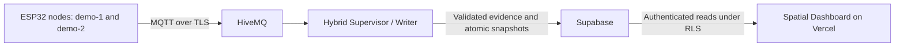

# OMNISense Edge — SDP Competition Submission

**OMNISense Edge is our Sime Darby Property (SDP) competition submission:** an
occupancy-aware building monitoring prototype with an interactive Spatial Dashboard.

Ceiling-mounted ESP32 nodes supply thermal headcount categories, temperature and
humidity. Hybrid Mode B combines that hardware evidence with stored decisions,
illustrative expected-use windows and simulated cooling responses. Real ESP32 →
MQTT → Supabase → Dashboard operation has been exercised in supervised tests.
The current Hybrid path does not actuate building HVAC or establish measured
energy savings.

## 🌐 Live Demo — OmniSense Spatial Dashboard

Explore our deployed OmniSense intelligent building management dashboard.

**Live Website:** [https://omnisense-hybrid-spatial.vercel.app](https://omnisense-hybrid-spatial.vercel.app)

### 🔐 Demo Access for Judges

To explore the Spatial Workspace, please use the following demonstration credentials:

**Email:** `reader-a@omnisense.test`

**Password:** `joshua0322`

These credentials are intentionally public and are for dedicated, read-only competition demo access only.

**How to Access:**

1. Open the live website using the link above.
2. Click **Enter Workspace** on the landing page.
3. Sign in using the provided demo credentials.
4. Explore the OmniSense Spatial Dashboard.

### What You Can Explore

- **Interactive 3D Workspace** — Explore the monitored room and sensor locations.
- **AI-Powered Occupancy Monitoring** — View people-count detection from ESP32-based thermal sensors.
- **Environmental Monitoring** — Examine temperature and humidity readings.
- **Intelligent Cooling** — Explore occupancy-aware cooling decisions and target temperatures.
- **Historical Analytics** — Review recorded sensor data, occupancy trends and operating records.

**Note:** The workspace contains real sensor data collected from our ESP32 prototype. Live updates are available when the physical devices and Hybrid data-ingestion service are running. Otherwise, the dashboard displays the latest stored historical data. HVAC control outputs represent controller targets rather than verified physical air-conditioning operation.

Website: [omnisense-hybrid-spatial.vercel.app](https://omnisense-hybrid-spatial.vercel.app).
The landing page is public. Workspace data requires an approved private account
and an exact-run Supabase reader grant. Repository access does not grant data access.

## Architecture



The Supervisor normalizes telemetry, checks freshness and fuses occupancy before
committing snapshots. The Dashboard reads the committed run boundary; it does not
subscribe to MQTT or compute replacement cooling policy. Forecasts and reported
cooling outputs retain their synthetic provenance. See the
[current architecture and capability boundaries](docs/SDP-SUBMISSION.md).

The Writer is a separate long-running service, not browser code or a Vercel
Function. Its host must remain running for live updates. After it stops, the
website can display stored records with freshness and unavailable-data handling.
The Spatial Workspace does not use the retained legacy Control API.

## Implemented scope

- Public landing → sign-in → protected workspace, memory-only session, logout
  and exact allowed-origin checks. Browser refresh requires sign-in again.
- Interactive 2D Floor Overview and rotatable/zoomable 3D office, node selection,
  per-node occupancy/headcount category, temperature, humidity and history.
- Usage & Cooling: shared elapsed-time axis, zoom/pan, pinned historical inspector,
  forecast-as-of interpretation, four cooling modes and timestamp-based utilization.
- Operating Records: server-side search/filtering, pagination, exact correlated
  details, full filtered CSV export, cancellation and spreadsheet formula protection.
- Hybrid normalization/fusion, receipt freshness, conservative missing-data states,
  atomic checkpoints, exclusive fenced Writer lease and sanitized diagnostics.
- Separate synthetic model and offline replay/regression tests.

The configured representative node supplies zone environmental readings; the UI
does not silently average nodes. One shared cooling zone is supported. Surrounding
floorplan rooms and approximate sensing footprints are illustrative. Counts such
as `3+` are categories, not an exact census. `full_zone_coverage=false` means two
empty node readings do not establish confirmed whole-zone vacancy.

Forecasts in this demonstration use synthetic schedules, not a trained prediction
service or live booking integration. Cooling acknowledgements are simulated
records, not proof that equipment operated.

## Implementation status and planned capabilities

| Capability | Current status |
| --- | --- |
| ESP32 telemetry ingestion, authenticated spatial monitoring, history and CSV | Implemented; supervised hardware path and offline regression tests exercised |
| Thermal people count | Firmware-reported categories (0, 1, 2, 3+); model accuracy is not independently established here |
| Occupancy-aware cooling requests | Implemented policy demonstration; Hybrid output acknowledgements are simulated |
| Forecast display and pre-cooling timeline | Implemented using illustrative stored schedules; trained prediction and live booking integration are future work |
| Physical BMS / building AC control | Future integration; no verified building HVAC actuation |
| Energy savings and full-room sensing coverage | Require field validation; no measured savings claim; `full_zone_coverage=false` |
| Firmware PMV | Present in the supplied firmware snapshot; persistence, migration 004 and dashboard display remain unfinished work outside this stable release |
| Continuous cloud Writer hosting | Future deployment work; the demonstration Writer currently runs separately from Vercel |

### Hardware reproduction limits

ESP32 firmware and TinyML model source are **not included in this public tree yet**.
The newly supplied firmware ZIP has been audited separately; a sanitized candidate
awaits review before inclusion. It lacks the referenced inference-library export,
model weights and pinned board/library settings. Its configured identity is
`demo-2`; source-to-flashed-binary equivalence for both physical nodes is not
established. See the [firmware audit](docs/FIRMWARE-AUDIT.md). The web/backend
offline checks remain reproducible without that hardware toolchain.

## Repository guide

| Path | Role in the current submission |
| --- | --- |
| `apps/dashboard/` | Public landing, authentication, 2D floor, 3D workspace, Usage & Cooling, Operating Records and CSV |
| `services/sdp-generator/` | Current Hybrid Supervisor/Writer, telemetry normalization, policy and separate synthetic generator |
| `packages/sdp-contract/` | Shared typed SDP envelopes, validation and contract fixtures |
| `supabase/` | SDP schema sources alongside retained prototype database material |
| `supabase/sdp/migrations/` | Current SDP foundation and Hybrid migration sources; never apply automatically |
| `scripts/` | Offline release/security checks plus retained development utilities |
| `docs/` | Current submission/runbooks and clearly indexed historical material |
| `services/mqtt-subscriber/`, `services/control-api/` | Earlier Technothon services; not required by the current Hybrid Spatial path |
| `docs/design/` | Design prototypes and landing source assets; not independent live services |

The project evolved from an earlier Technothon prototype. The SDP submission adds
the Spatial Dashboard and isolated Hybrid pipeline described above, while retaining
earlier modules and history for traceability. Old demo scripts and service guides
are not the current startup path. No legacy code is being archived in this update.
Use the [documentation index](docs/README.md) to choose current instructions.

## Installation

Use **Node.js 24** and Python 3 for the release audit.
Run from the repository root. On Windows use `npm.cmd` if PowerShell blocks
`npm.ps1`; use `npm` on other systems.

```powershell
npm.cmd --prefix apps/dashboard ci --no-audit --no-fund
npm.cmd --prefix services/sdp-generator ci --no-audit --no-fund
npm.cmd --prefix packages/sdp-contract run build
npm.cmd --prefix services/sdp-generator run build
```

Each runnable package has its own lockfile; there is no root npm workspace install.
Installation downloads dependencies. Validation below never installs or upgrades
packages and blocks external Node HTTP/MQTT connections.

## Safe offline evaluation — no accounts or cloud access

```powershell
node scripts/validate-release.mjs
python scripts/audit-public-release.py
```

Validation runs contracts, generator/database tests against disposable in-process
PGlite, dashboard tests, TypeScript and the production frontend build. It executes
no hosted SQL. With no configuration, the website shows its public landing and an
honest unavailable/setup state rather than fabricated operational readings:

```powershell
npm.cmd --prefix apps/dashboard run dev
```

Use the printed URL; `/workspace` opens the workspace route. To replay telemetry
or generate a bounded offline synthetic sample without connecting to MQTT/Supabase:

```powershell
node services/sdp-generator/hybrid-mqtt.mjs --replay services/sdp-generator/test/fixtures/firmware-replay.json
node services/sdp-generator/index.mjs --frames 3
```

These CLI commands do not load private environment files implicitly.

## Configured Dashboard and Backend

See [safe runtime setup](docs/PUBLIC-RUNTIME.md) for environment-variable templates,
target registration and operator-only startup. Templates contain no credentials:

| Purpose | Template | Private local destination |
| --- | --- | --- |
| Synthetic read-only Dashboard | `apps/dashboard/.env.example` | `apps/dashboard/.env` |
| Private Hybrid Dashboard | `apps/dashboard/.env.hybrid.example` | `apps/dashboard/.env.hybrid.local` |
| Hybrid Supervisor | `services/sdp-generator/hybrid-runtime.env.example` | `services/sdp-generator/hybrid-runtime.local.env` |

Do not point the Hybrid Writer at the synthetic project. Do not repeat existing
migrations, replace an ACTIVE run, grant readers or start another writer during
evaluation. Real operation needs explicit owner authorization and approved private
configuration; public source alone intentionally cannot enable live writes.

## Deployment and review

[Vercel frontend instructions](docs/integration/VERCEL-HYBRID-FRONTEND.md) describe
audited static prebuilt packaging with one exact production origin. The existing
Vercel deployment is independent of this GitHub release. Keep automatic GitHub
deployment disconnected unless separately approved.

See [release boundaries](docs/PUBLIC-RELEASE.md) and [security policy](SECURITY.md).
Older integration reports describe dated test stages and contain non-secret
project/run/test-user identifiers; they are not current setup instructions.
Do not publish private environments, manifests, populated approval registries,
Vercel metadata or new raw runtime evidence.
