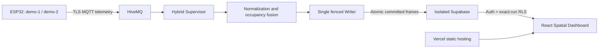

# OMNISense Edge — current SDP submission

OMNISense Edge connects a two-node ESP32 prototype to a spatial monitoring
workspace for the Sime Darby Property competition. Its earlier Technothon history
is retained; the current application is the Hybrid Mode B backend and Spatial
Dashboard, rather than the legacy subscriber/control stack.

## Running architecture

1. Firmware sends node identity, headcount category, PIR/AI metadata and
   environmental readings. The audited ZIP also sends PMV/PPD and local fan state,
   which the stable Hybrid normalizer does not persist.
2. The Supervisor validates the approved target and manifest, owns one Writer,
   checks MQTT receipt freshness and conservatively fuses evidence. Inactive,
   fallback and missing readings do not establish confirmed vacancy.
   `full_zone_coverage=false` remains required for this setup.
3. Supabase stores evidence, decisions, schedules, simulated outputs and committed
   sequence boundaries. Credentials and runtime approvals remain local.
4. The Dashboard reads the authorized ACTIVE run and committed snapshots. History,
   utilization and CSV share those boundaries. The representative environmental
   node supplies zone readings; node values are not silently averaged.
5. The landing is public. Workspace reads require authentication and a run grant.
   Sessions are memory-only; reload requires sign-in. Reader A has dedicated
   read-only demo access; Reader B remains ungranted.

The Writer runs separately from Vercel and the browser. Stopping its host stops
ingestion; stored records remain inspectable with actual timestamps/freshness.
Repository access does not grant database access.

## Verified functionality and limits

| Area | Implemented / exercised | Limit or next step |
| --- | --- | --- |
| Hardware path | Supervised ESP32 → HiveMQ → Writer → Supabase → Dashboard session | ZIP is not a binary attestation for both devices |
| Monitoring | 2D floor, 3D node inspection, headcount categories, temperature/humidity and history | No calibrated full-room coverage or independent AI accuracy validation |
| Cooling | Four stored request modes, freshness policy, exact decision correlation | Hybrid acknowledgements are simulated; building HVAC/BMS integration is future work |
| Forecasts | Stored schedules, restart annotations and historical-as-of display | Illustrative schedules; no trained predictor or real booking feed |
| Analytics | Elapsed-time utilization, unknown coverage, records and filtered CSV | Requested operation is not measured energy or verified AC runtime |
| Access | Public landing, private workspace, origin restriction and exact-run RLS | Only dedicated read-only demo credentials are public |
| PMV | Supplied firmware computes an estimate with fixed assumptions | Stable evidence/readers/UI do not support it; unfinished work is excluded |
| Local actuation | Supplied firmware contains PWM demonstration-fan logic | Separate from Hybrid outputs; not building AC actuation |
| Deployment | Static Vercel frontend with a separate Writer host | Always-on Writer hosting and energy-saving validation remain future work |

## Reproduction boundary

The public source supports offline contract, backend, database, dashboard and
build checks with Node.js 24; see the [root commands](../README.md).
Tests use disposable local databases and constructed fixtures, not cloud changes.

Firmware and TinyML model source are not yet in this public tree. The owner's
new ZIP has 12 application source files but lacks the inference export, model
weights, pinned library versions and exact board build settings. It is not a
complete hardware reproduction package. A sanitized candidate is being reviewed
outside Git; see [the audit](FIRMWARE-AUDIT.md). A fresh clone cannot currently
train the model, recreate either flashed binary or reproduce model accuracy.

Live operation also needs private credentials, an original approved target
manifest and reader grants. Public examples cannot approve a target or replace
an ACTIVE run. Do not repeat migrations or start another Writer for evaluation.

## Source navigation

- [Frontend](../apps/dashboard/): Spatial UI, authentication, readers and tests.
- [Backend](../services/sdp-generator/): Hybrid Supervisor/Writer and separate
  synthetic generator, normalization, policy and offline tests.
- [Shared contract](../packages/sdp-contract/): types and validation.
- [SDP database source](../supabase/sdp/): migrations, tests and verification.
- [Release utilities](../scripts/): offline/security checks and retained helpers.
- Legacy [subscriber](../services/mqtt-subscriber/) and
  [Control API](../services/control-api/): historical, not part of the Hybrid path.
