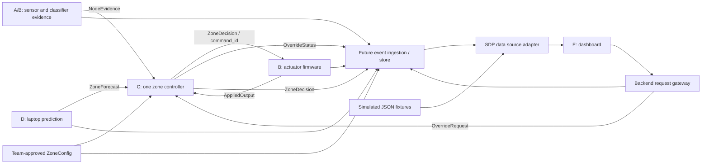

# SDP Integration Contract v1 Draft

**Status: DRAFT FOR A/B/C/D/E REVIEW. Not finalized or deployed.**

- Wire identifier: `sdp.v1-draft.1`.
- Package version: `1.0.0-draft.1` in `packages/sdp-contract`.
- Basis: SDP work brief pages 6-11, especially Part E on pages 9-11.
- Scope: seven message types, simulated examples, validation and a read-only dashboard data boundary.
- Existing Technothon MQTT topics, subscriber, Control API, firmware and Supabase tables remain unchanged. The dashboard adds an isolated, read-only SDP mock tab; existing Technothon views retain their behavior.

This draft lets teammates develop against the same shapes. It does not establish that firmware acknowledgements, zone control, prediction or a new backend ingestion path already exist. Contract tests check messages and fixture consistency, not algorithm correctness or physical AC performance.

## Start Here

1. Review `packages/sdp-contract/src/types.ts` for the exact TypeScript interfaces and `src/validate.ts` for runtime validation.
2. Inspect `packages/sdp-contract/fixtures/scenarios.json`. It contains **simulated test data only**: an event catalog and isolated scenario selections.
3. C should consume NodeEvidence, ZoneConfig, ZoneForecast and OverrideRequest, then produce ZoneDecision and controller-owned OverrideStatus events.
4. D should consume authoritative zone history and produce ZoneForecast events. It does not infer current vacancy or command equipment.
5. B reports AppliedOutput against C's `command_id` and decision event ID. E displays the distinction between requested, accepted and applied.
6. Agree the pending decisions below before connecting any proposed transport to hardware.

## Architecture and Ownership



The diagram is a target integration proposal. The event store/gateway extensions are not implemented here. The browser does not connect to MQTT. Credentials stay in backend configuration. Prediction and controller execution must continue independently of the dashboard.

| Message | Producer / owner | Consumers | Responsibility |
| --- | --- | --- | --- |
| NodeEvidence | A/B, published by B | C, event store, E; D may inspect records | Classifier evidence and individually sourced environmental readings. |
| ZoneConfig | Team-approved configuration, published by C | A/B, C, D, E | One cooling boundary, required nodes, representative sensor, limits and timing configuration. E can provide map positions for agreement. |
| ZoneDecision | C | B, D, event store, E | Authoritative combined occupancy, requested mode, reason, coverage and evidence references. |
| ZoneForecast | D | C, event store, E | Next-use window and restart proposal, quality, source, issue/expiry and cancellation. |
| AppliedOutput | B | C, event store, E | Accepted/applied/rejected/failed actuator result. |
| OverrideRequest | E through backend gateway | C, event store | Expiring requested occupied operation/permitted setpoint, or Return to Automatic. |
| OverrideStatus | E/gateway for PENDING; C thereafter | E, event store | Request acceptance, application, failure and end of override. C incorporates B's output report before reporting APPLIED. |

## Common Envelope

Every event has the following required fields. A field typed `T | null` is **required but nullable**; do not omit it. This deliberately distinguishes unavailable values from accidentally missing fields. There are no optional wire fields in draft.1; action-specific fields use a discriminated union instead.

| Field | Type / rule |
| --- | --- |
| `schema_version` | Literal `sdp.v1-draft.1`; consumers reject other versions. |
| `event_type` | `NODE_EVIDENCE`, `ZONE_CONFIG`, `ZONE_DECISION`, `ZONE_FORECAST`, `APPLIED_OUTPUT`, `OVERRIDE_REQUEST`, `OVERRIDE_STATUS`. |
| `event_id` | Globally unique, opaque, immutable event ID. Production producers should use UUIDs; fixture IDs are readable strings. Retry the same event with the same ID and content. |
| `correlation_id` | Shared trace ID for related requests/decisions/output events. It is not a substitute for exact event references. |
| `session_id` | Test/live session ID, shared by the relevant producers. Keep independent runs isolated. |
| `room_id`, `zone_id` | Stable room and actual cooling-zone identities; not sensor footprint names. |
| `occurred_at` | Event issue/report time in its declared time base, UTC ISO 8601 ending in `Z`, seconds or exactly three fractional digits. |
| `clock` | `{ "time_base": "LIVE", "replay_id": null }` or `{ "time_base": "REPLAY", "replay_id": "run-id" }`. |
| `producer` | `{ "component": "A_B" | "B" | "C" | "D" | "E", "producer_id": "stable-producer-id" }`. Component ownership is validated. |
| `data_sources` | Non-empty array drawn from `MEASURED`, `PROXY_TEST`, `SIMULATED`, `UNAVAILABLE`; summary of the inputs/basis, not a claim that an algorithmic decision is directly measured. |
| `payload` | Exact payload for the event type below. Unknown fields are rejected by this draft's validator. |

Proposed storage may attach `received_at` outside the immutable wire event. Do not replace observation time with ingestion time. Record model/firmware versions from NodeEvidence and prediction method/cooling model versions from forecasts with the session records.

### Observation and provenance

NodeEvidence uses `Observation<T>` independently for classification, temperature and humidity:

```json
{
  "value": 61.5,
  "source": "SIMULATED",
  "source_id": "demo-1",
  "observed_at": "2026-10-20T08:03:00.000Z",
  "validity": "VALID"
}
```

- `value`: typed value when VALID; `null` when INVALID or UNAVAILABLE.
- `source`: `MEASURED` for actual measurements; `PROXY_TEST` for labelled proxy experiments; `SIMULATED` for generated/replayed synthetic inputs; `UNAVAILABLE` for absent input.
- `source_id`: originating node/test source, required for VALID; otherwise nullable.
- `observed_at`: original acquisition/window-end time, required for VALID; otherwise nullable.
- `validity`: `VALID`, `INVALID`, `UNAVAILABLE`. Invalid sensor readings are not zero or vacant evidence. Historical valid evidence can later become stale without changing this field.

Hybrid inputs retain their own sources and observation times. Copying demo-1 temperature into a demo-2 presentation must retain demo-1 as its origin; it does not establish a second independent measurement. All packaged fixtures use SIMULATED, with UNAVAILABLE where appropriate. Class scores describe model outputs, not calibrated probabilities of correctness. Temperature/humidity and limits do not establish complete thermal comfort; PMV is absent from this contract.

## Payload Definitions

The TypeScript interfaces are the machine-readable shape reference. The descriptions below define the intended semantics; all listed fields are required unless an action excludes them.

### NodeEvidence

| Fields | Meaning |
| --- | --- |
| `node_id`, `model_version`, `firmware_version` | Sensor and software identifiers. A valid model/version label is required even for an unavailable evidence event. |
| `classification` | `Observation<ClassifierEvidence>`; `value` contains `class_label`, `class_scores`, `headcount_category` when valid. |
| `class_label`, `class_scores` | Labels/score keys: `EMPTY_CORE`, `THERMAL_ANOMALIES`, `OCCUPIED_1P`, `OCCUPIED_2P`, `OCCUPIED_3P_PLUS`. All five score keys are required, each 0-1. Draft does not enforce score normalization or interpret anomalies as empty. A must confirm these names. |
| `headcount_category` | `ZERO`, `ONE`, `TWO`, `THREE_PLUS`, `UNCERTAIN`. Classification unavailable uses null observation value, not a fabricated category/count. THREE_PLUS must display as "3 or more", not exact 3. |
| `temperature_c`, `humidity_percent` | Independent `Observation<number>` values; degrees Celsius and relative humidity 0-100. Either may be unavailable. |

This event carries node evidence; C determines whether it is reliable/current and combines it at zone level. Do not add overlapping count estimates into a building total without agreed duplicate handling.

### ZoneConfig

| Fields | Meaning |
| --- | --- |
| `config_version`, `effective_from` | Configuration revision and time it becomes effective. Decisions reference the exact config event ID. |
| `controller_id`, `actuator_id`, `actuation_kind` | Nominated controller/actuator; `FAN_PROXY` or `HVAC_INTERFACE`. FAN_PROXY demonstrates modes, not AC energy use. |
| `required_nodes` | Non-empty unique list of `{node_id, label, x, y}`; x/y are normalized map positions in [0,1]. All listed nodes belong to this one cooling zone. |
| `representative_environment_node_id` | Required-node ID supplying representative environmental readings. Sensor selection/absence policy belongs to C. |
| `freshness` | `stale_after_ms`, `disconnected_after_ms`, `max_clock_skew_ms`; disconnect threshold exceeds stale threshold. |
| `vacancy_confirmation_ms`, `min_mode_dwell_ms`, `override_max_duration_ms` | Positive configuration durations enforced by C, never calculated by the UI. |
| `limits` | `temperature_min_c`, `temperature_max_c`, `humidity_max_percent`, `occupied_target_c`; ordered limits and target within range. |

Fixture configuration maps demo-1 and demo-2 to **one zone**, with separate observed footprints. It deliberately does not make the legacy missing nodeA a required sensor. Mapping, limits, timer values and actuator mapping are review placeholders, not adopted engineering settings.

### ZoneDecision

| Fields | Meaning |
| --- | --- |
| `command_id`, `config_event_id` | C's idempotent directive ID and exact configuration event. B echoes command_id and this decision's event_id in AppliedOutput. Re-delivery does not create a new command. |
| `occupancy` | `OCCUPIED`, `VACANT`, `UNCERTAIN`; authoritative combined result supplied by C. |
| `coverage` | `COMPLETE`, `DEGRADED`, `UNKNOWN`; C's coverage assessment, not a numeric confidence probability. |
| `requested_mode` | `OCCUPIED`, `SHORT_VACANCY`, `LONG_VACANCY`, `PRECOOL`. These are controller states, not legacy HVAC strings such as cool/eco. |
| `requested_output` | Nullable `{fan, setpoint_c}`. Fan: `OFF`, `LOW`, `MEDIUM`, `HIGH`, `AUTO`; setpoint is nullable Celsius. C/B agree the mapping. This is requested, not confirmed. |
| `reason_code`, `reason_text` | Stable enum below plus readable explanation from C. |
| `evaluated_at`, `vacancy_confirmed_at` | C evaluation time; nullable vacancy confirmation time. Neither may follow evaluation/publication in an impossible order. |
| `node_states` | One entry for each configured required node: `{node_id, state, evidence_event_id}`. State is `FRESH`, `STALE`, `DISCONNECTED`, `MISSING`, `INVALID`. MISSING has null evidence reference; others reference an evidence event. |
| `forecast_event_id`, `override_request_id` | Nullable links to inputs used for this decision. An available forecast is not necessarily used. |

Reason codes: `OCCUPIED_EVIDENCE`, `VACANCY_CONFIRMED`, `SHORT_GAP`, `LONG_GAP`, `FORECAST_RESTART`, `MISSING_EVIDENCE`, `UNCERTAIN_EVIDENCE`, `MANUAL_OVERRIDE`, `OVERRIDE_EXPIRED`, `RETURN_TO_AUTOMATIC`, `ENVIRONMENT_LIMIT`, `CONSERVATIVE_FALLBACK`.

C owns the rules: credible occupied evidence keeps a zone occupied; confirmed vacancy requires all required coverage fresh/reliably vacant for the agreed period; missing coverage is unknown; forecasts never prove vacancy. This package does not implement those rules. The UI displays the supplied decision and flags, rather than reconstructing them from node counts. PRECOOL and OCCUPIED may request the same fan output but have different reasons/timing.

### ZoneForecast

| Fields | Meaning |
| --- | --- |
| `status` | `ACTIVE`, `CANCELLED`, `UNAVAILABLE`. EXPIRED is a consumer display state when an ACTIVE event reaches its deadline, not a new forecast calculated by E. |
| `source`, `quality` | Source `HISTORY`, `BOOKING`, `NONE`; qualitative quality `HIGH`, `MEDIUM`, `LOW`, `UNAVAILABLE`. A booking is not a learned prediction. |
| `next_use_window` | Nullable `{start, end}` UTC times with end after start. ACTIVE requires a window. |
| `planned_restart_at` | Nullable restart proposal, at or before the window start; ACTIVE requires it. D computes it, C decides whether to use it. |
| `expires_at` | Deadline for using the plan; ACTIVE expiry must follow issue time. |
| `method_version`, `cooling_model_version` | Method and nullable assumed thermal-response model revision. No implied measured AC response. |
| `supersedes_event_id`, `status_reason` | Nullable prior forecast reference and explanation. Cancellation requires both, and clears window/restart. UNAVAILABLE requires a reason, unavailable quality and null plan. Updates to an existing plan must reference the prior event. |

D emits a new immutable event when updating/cancelling a forecast; never edit history. Sparse history can produce UNAVAILABLE with a reason. After expiry, C owns fallback and E shows the plan as expired. The adapter never turns forecast expiry into a cooling command.

### AppliedOutput

`command_id`, `decision_event_id`, `actuator_id` identify C's directive. `status` is ACCEPTED, APPLIED, REJECTED or FAILED. `reported_output` is required and non-null only for APPLIED; it has the OutputSetting shape above. `reason` is nullable but required non-empty for REJECTED/FAILED. `feedback_basis` is FIRMWARE_REPORT, PHYSICAL_FEEDBACK or SIMULATED.

An APPLIED firmware report means firmware reports completing the output change. Claim physical confirmation only with appropriate PHYSICAL_FEEDBACK. Fan-proxy application does not prove physical AC cooling. Preserve prior output history on a failed new command; do not invent a new applied value.

### OverrideRequest

All requests contain `request_id`, `valid_until` and `reason`. `request_id` is stable across retries with identical content; the backend/C must reject conflicting reuse. `valid_until` is the acceptance deadline, not the override end time.

| Action | Additional required fields |
| --- | --- |
| `SET_OVERRIDE` | `requested_mode: "OCCUPIED"`, nullable `requested_setpoint_c`, `override_expires_at`. Expiry must follow the acceptance deadline; C enforces configured maximum duration and environmental/equipment limits. |
| `RETURN_TO_AUTOMATIC` | `target_request_id` naming the specific original override, preventing cancellation of an unrelated newer override. It does not carry a mode/setpoint/override expiry. |

Examples below are **payloads only**, placed inside the common envelope:

```json
{
  "request_id": "request-occupied",
  "valid_until": "2026-10-20T08:03:12.000Z",
  "reason": "Simulated operator review request.",
  "action": "SET_OVERRIDE",
  "requested_mode": "OCCUPIED",
  "requested_setpoint_c": 24,
  "override_expires_at": "2026-10-20T08:13:02.000Z"
}
```

```json
{
  "request_id": "request-return",
  "valid_until": "2026-10-20T08:03:30.000Z",
  "reason": "Simulated Return to Automatic.",
  "action": "RETURN_TO_AUTOMATIC",
  "target_request_id": "request-occupied"
}
```

### OverrideStatus and control outcomes

Fields: `request_id`, `status`, non-empty `reason`, nullable `decision_event_id`, nullable `applied_output_event_id`, nullable `effective_until`. `effective_until` is C's accepted override end, not the gateway's send time; it is null for a Return to Automatic result. APPLIED requires decision and applied-output references.

| Stage | What E may say | What it must not imply |
| --- | --- | --- |
| OverrideRequest / PENDING | Request submitted / awaiting controller | Accepted or applied. HTTP/MQTT publication alone proves neither. |
| ACCEPTED | C accepted the request; B accepted a directive where separately reported | Physical output changed. |
| APPLIED | C confirmed the correlated B APPLIED result; show feedback basis | Metered AC energy savings or independent physical feedback when absent. |
| REJECTED | Request/directive refused with reason | A previous mode was cancelled or replaced. |
| FAILED | Accepted processing/output attempt failed | Target output was successfully reached. |
| EXPIRED | C ended an override at expiry | Automatic means OFF; C publishes the resulting automatic decision. |
| CANCELLED | Original override ended early, e.g. after Return to Automatic | Cancelling alone proves a new output was applied. |

Normal path: PENDING -> ACCEPTED -> APPLIED -> EXPIRED/CANCELLED. PENDING may become REJECTED; accepted work may become FAILED or expire before application. Return to Automatic has its own request/status chain, followed by CANCELLED for the original override. C must enforce expiry even without an open dashboard or network connection. Events record transitions; this package does not enforce a distributed state machine or implement timers/controllers.

## Example Catalog and Scenarios

Complete, directly parseable wire examples are in `packages/sdp-contract/fixtures/scenarios.json`, under `events`. No ellipses or template-only references appear in those event objects.

| Event type | Example event IDs |
| --- | --- |
| ZoneConfig | `config-demo` |
| NodeEvidence | `evidence-occupied-1`, `evidence-occupied-2`, `evidence-uncertain-2`, `evidence-unavailable-temperature` |
| ZoneDecision | `decision-occupied`, `decision-confirmed-vacancy`, `decision-short-vacancy`, `decision-long-vacancy`, `decision-precool`, `decision-missing-node` |
| ZoneForecast | `forecast-return`, `forecast-expired`, `forecast-cancelled`, `forecast-unavailable` |
| AppliedOutput | `output-normal-applied`, `output-command-accepted`, `output-command-rejected`, `output-command-failed` |
| OverrideRequest | `override-request`, `return-request` |
| OverrideStatus | `override-pending`, `override-accepted`, `override-applied`, `override-expired`, `override-rejected`, `override-failed`, `return-applied` |

The 22 scenario IDs are: `normal-occupied`, `confirmed-vacancy`, `short-vacancy`, `long-vacancy`, `precool`, `missing-node`, `stale-node`, `uncertain-occupancy`, `unavailable-environment`, `expired-forecast`, `cancelled-forecast`, `unavailable-forecast`, `override-pending`, `override-accepted`, `override-applied`, `override-expired`, `override-rejected`, `override-failed`, `return-to-automatic`, `command-accepted`, `command-rejected`, `command-failed`.

Each scenario selects `event_ids` from the catalog and declares its own query/as-of time. **Do not combine alternative scenario selections into one history**: accepted, rejected and failed branches are intentionally alternative outcomes. The full catalog is not a single causal run. The expired-override example returns to a scripted conservative automatic mode because its old evidence is disconnected. Fixture snapshots do not prove vacancy-confirmation windows, control performance, forecasting accuracy or real device health.

## Timestamp, Freshness and Ordering Rules

- Use one session/time base across the participating producers. LIVE timestamps use synchronized UTC. REPLAY timestamps use the agreed virtual clock and a unique replay_id; replay speed and wall-clock time are separate concerns.
- `observed_at` is original evidence time; `occurred_at` is event publication/report time. Within a node event, observation cannot follow publication. Controller `evaluated_at` cannot follow its event publication. A future production receiver should separately record its own receipt time.
- C evaluates evidence age from the original observation in its own agreed time base. Proposed boundaries: age < stale threshold is fresh; stale <= age < disconnected is stale; age >= disconnected is disconnected. Never-seen required nodes are missing. Validity is separate; C records INVALID when evidence cannot be used. Max clock skew handling requires agreement.
- The adapter filters events after the explicit query `as_of`; it never calls browser Date.now() for replay. ACTIVE forecasts become display-EXPIRED at `as_of >= expires_at`. Requests must be accepted before valid_until; expired forecasts/requests must not be acted on.
- An expiry/status display does not issue a new controller action. Only C emits decisions and override-end status. Firmware/C owns safe behavior during loss of communication.
- Unique event IDs support deduplication at future ingestion. Referenced event IDs must resolve to the same session/zone/time base and not point into the future. Commands share C's command_id; overrides share request_id. Reject conflicting reused IDs.
- The read adapter sorts by event time then event ID for deterministic display. ID tie-breaking is not causal ordering. Draft producers should avoid equal-time contradictory updates to the same entity; controller sequence/boot IDs remain an agreement item. Consumers must resolve lifecycle meaning using references/statuses, not packet arrival order alone.
- No retained command delivery is proposed. QoS, retention and persistence are not implemented/decided by this contract. Never replay synthetic actuation requests onto real hardware without an explicitly isolated test transport.

## Minimal Dashboard Data Boundary

`apps/dashboard/src/api/sdp.ts` exposes the mock catalog and imports the shared domain types. Only the isolated SDP Zone Overview tab consumes it; it makes no network requests. The tab displays controller-provided decisions and output reports, and labels all fixture records as simulated. `SdpZoneView` accepts an `SdpDataSource` and explicit `EventQuery` so a future backend adapter can replace the fixtures without changing the panels' domain types. See `apps/dashboard/README.md` for scenario and UI verification steps.

```ts
import { getSdpMockScenario } from "./api/sdp";

const { source, query } = getSdpMockScenario("override-applied");
const snapshot = await source.getZoneSnapshot(query);
// Render snapshot.decision, snapshot.output and override statuses separately.
```

`SdpDataSource` has `getEvents(query)` and `getZoneSnapshot(query)`. Query requires session_id, zone_id, clock and explicit as_of. Snapshot returns effective config, latest evidence per node, latest C decision, forecast/display expiry, latest output report for that exact decision, override histories and selected events. It does not fuse occupancy, calculate mode, assume a request succeeded or reuse an old decision's output as a new decision's acknowledgement. If a view needs last confirmed physical output, inspect the separate event history and label its original decision/time.

Future backend integration can use the same boundary and types:

```ts
import { createSdpDataSource } from "./api/sdp";

const source = createSdpDataSource(async query => {
  // Proposed backend loader: fetch a complete, scoped event array for query.
  // Unwrap stored row.event if receipt metadata is stored separately.
  return loadEventsFromFutureBackend(query);
});
```

The loader callback above is a sketch, not an existing function or endpoint. It must handle pagination before returning complete scoped results. Runtime validation runs at the boundary and throws actionable errors; future views can map these promises to their loading/empty/error states. Foreign-session/zone/time-base events and future events are filtered. No new Supabase schema, MQTT subscriptions or API endpoints are introduced in this phase.

## Validation and Local Checks

The [C/D Integration Kit](sdp-integration-kit.md) includes concise producer guides,
standalone valid/invalid JSON examples and a local CLI around this same validator.
See the [C guide](sdp-component-c-guide.md) and [D guide](sdp-component-d-guide.md)
for teammate handoff requirements. All interfaces remain review drafts.

The package has no new dependencies. Its scripts reuse the TypeScript compiler already installed for apps/dashboard. On a fresh clone, first install the dashboard dependencies using the existing setup (`npm.cmd --prefix apps/dashboard ci`). Then, from the repository root:

```powershell
npm.cmd --prefix packages/sdp-contract run typecheck
npm.cmd --prefix packages/sdp-contract test
npm.cmd --prefix apps/dashboard run typecheck
npm.cmd --prefix apps/dashboard run build
```

Package test builds ignored `dist/` output and uses Node's built-in test runner. Tests cover all fixture messages, required keys/enums, owners, timestamp/nullable/provenance rules, request/forecast lifecycle consistency, exact event references, fixture freshness, replay isolation, empty/error states and output acknowledgement distinctions. Validation intentionally does not implement C fusion/decision rules or D forecasting, nor prove real broker/device integration. Runtime single-event validation cannot verify external references or full lifecycle history; fixture tests do those checks against the packaged catalog. Future ingestion must add equivalent scoped reference/idempotency checks.

## C Integration Checklist

- [ ] Agree controller execution location, zone/actuator identity, required nodes and footprint overlap.
- [ ] Accept the versioned evidence/config/forecast/override shapes; use the shared fixtures or equivalent language-specific validation.
- [ ] Publish combined occupancy, coverage, requested mode, reason and exact input references as ZoneDecision.
- [ ] Own freshness, vacancy confirmation, minimum dwell, safety/environment limits and conservative fallback; never ask E to calculate a second controller decision.
- [ ] Issue stable command IDs; consume B acknowledgements; distinguish accepted from applied; report failures honestly.
- [ ] Enforce request acceptance deadlines and override expiry locally; emit correlated OverrideStatus transitions and Return to Automatic decisions.
- [ ] Reject expired forecasts, handle cancellation/update, and keep occupied evidence authoritative over predictions.
- [ ] Export immutable operating events with session, software/config references and provenance for E/D.

## D Integration Checklist

- [ ] Consume C's combined zone occupancy history, not summed per-node headcounts.
- [ ] Keep live, synthetic/replay and booking inputs labelled; do not present bookings as learned predictions.
- [ ] Emit forecast source/quality, window, planned restart, issue/expiry and method/assumption versions.
- [ ] Emit UNAVAILABLE when no supported estimate exists; use qualitative weak quality rather than invented probabilities.
- [ ] Emit new referenced events when updating/cancelling a plan; C remains final decision owner.
- [ ] Use the agreed replay clock and reveal only past inputs to the predictor; keep future ground truth in the evaluator.
- [ ] Agree later comparison records/metrics for identical scenarios and sensing inputs; do not claim metered AC savings from synthetic temperatures or fan outputs.

## Team Decisions Still Required

| Decision | Suggested owner / review |
| --- | --- |
| Finalize schema fields/enums and version transition from draft.1; confirm A class names and score interpretation | A/B/C/D/E |
| One real cooling boundary, sensor overlap, required nodes, controller location and actuator identity | B/C with E map support |
| Representative environmental sensor; actual permitted settings, limits, freshness/skew, vacancy/dwell/override durations | B/C; fixture values are placeholders |
| B command delivery shape and acknowledgement capabilities; fan mapping and firmware versus physical feedback | B/C |
| Forecast quality meanings, booking updates, assumed thermal model, cancellation/update ordering | C/D |
| Override authority, concurrent operators, replacement/timeout/rejection semantics, automatic return and device-offline recovery | B/C/E |
| Same-time ordering, sequence/boot IDs, late events, command retries, durable deduplication and replay isolation | B/C/D/backend |
| MQTT paths, ACLs, QoS, retained-state policy, backend ingestion and Supabase storage/RLS | B/backend/E |
| Session/version records, comparison metrics and export schema (not included in this draft's seven types) | C/D/E |

## Proposed MQTT Topics (Not Finalized)

| Message | Proposed path |
| --- | --- |
| NodeEvidence | `omnisense/sdp/v1/node/{node_id}/evidence` |
| ZoneConfig | `omnisense/sdp/v1/zone/{zone_id}/config` |
| ZoneDecision | `omnisense/sdp/v1/zone/{zone_id}/decision` |
| ZoneForecast | `omnisense/sdp/v1/zone/{zone_id}/forecast` |
| AppliedOutput | `omnisense/sdp/v1/zone/{zone_id}/output` |
| OverrideRequest | `omnisense/sdp/v1/zone/{zone_id}/override/request` |
| OverrideStatus | `omnisense/sdp/v1/zone/{zone_id}/override/status` |

These paths are review proposals only. The payload's explicit schema_version remains required; topic v1 does not finalize this draft. Verify topic/payload IDs at future ingestion. Keep all existing `omnisense/node/.../telemetry` and `/command` traffic unchanged. Do not send SDP messages to the current legacy validator: it intentionally still requires the old telemetry fields, including PMV.
