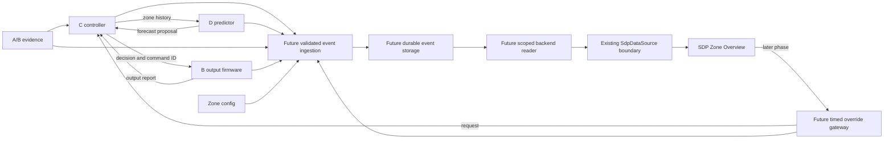

# SDP Integration Kit for C and D

**Version: `sdp.v1-draft.1` - draft for team review.**

- [Component C guide](sdp-component-c-guide.md): controller inputs, decisions,
  device reports and override references.
- [Component D guide](sdp-component-d-guide.md): zone history, forecasts,
  restart proposals, cancellation and expiry.
- [Canonical contract](sdp-contract-v1.md),
  [TypeScript types](../packages/sdp-contract/src/types.ts),
  [shared runtime validator](../packages/sdp-contract/src/validate.ts).
- [Standalone valid/invalid JSON](../packages/sdp-contract/fixtures/integration/README.md)
  and [22 scenario selections](../packages/sdp-contract/fixtures/scenarios.json).

The wire format is JSON regardless of the implementation language. The utility
calls the existing `validateSdpEvent()` function; there is no second schema or
algorithm. Existing types, validation rules, scenario catalog and dashboard
adapter stay the source of truth.

## Local Setup and Validation

Use the repository's Node.js prerequisite and existing dashboard setup. The CLI
requires no environment file, MQTT credentials, broker, Supabase or ESP32.
From the repository root, in Windows PowerShell:

```powershell
# Fresh clone only: install the existing dashboard/compiler dependencies.
npm.cmd --prefix apps/dashboard ci

# Build the shared TypeScript validator; repeat after contract source changes.
npm.cmd --prefix packages/sdp-contract run build

# Inspect CLI options.
node .\packages\sdp-contract\bin\validate.mjs --help

# File input: paths are relative to the current working directory.
node .\packages\sdp-contract\bin\validate.mjs --file .\packages\sdp-contract\fixtures\integration\c-zone-decision.valid.json --type ZONE_DECISION
node .\packages\sdp-contract\bin\validate.mjs --file .\packages\sdp-contract\fixtures\integration\d-zone-forecast.valid.json --type ZONE_FORECAST

# Expected failures: these examples intentionally violate the contract.
node .\packages\sdp-contract\bin\validate.mjs --file .\packages\sdp-contract\fixtures\integration\c-zone-decision.invalid.json
$LASTEXITCODE  # 1
node .\packages\sdp-contract\bin\validate.mjs --file .\packages\sdp-contract\fixtures\integration\d-zone-forecast.invalid.json
$LASTEXITCODE  # 1

# Validate your own output. Stdin avoids native argument quoting differences.
Get-Content -Raw .\my-c-decision.json | node .\packages\sdp-contract\bin\validate.mjs --stdin --type ZONE_DECISION
Get-Content -Raw .\my-d-forecast.json | node .\packages\sdp-contract\bin\validate.mjs --stdin --type ZONE_FORECAST
```

Inline JSON is also supported. In PowerShell 7.3+ with its default native argument
passing, this passes one complete JSON string without writing another file:

```powershell
$sdpMessage = Get-Content -Raw .\packages\sdp-contract\fixtures\integration\d-zone-forecast.valid.json
node .\packages\sdp-contract\bin\validate.mjs --json $sdpMessage --type ZONE_FORECAST
```

For Windows PowerShell 5.1 or shells that strip embedded quotes, use `--stdin` or
`--file`. UTF-8 JSON with or without a BOM is accepted. Quote paths containing
spaces, e.g. `--file '.\review outputs\forecast.json'`.

The npm convenience entry point is `npm.cmd --prefix packages/sdp-contract run validate -- --help`.
For file input through `npm --prefix`, npm runs the script
inside the package; resolve relative file paths from `packages/sdp-contract`.
Direct `node` commands above use the current directory instead.

| Exit code | Meaning |
| --- | --- |
| 0 | One valid event; optionally matches `--type`. |
| 1 | Invalid JSON, missing/wrong fields, semantic validation error or wrong requested event type. |
| 2 | CLI usage, input read or unavailable validator build. |

Successful output is `VALID ZONE_DECISION (sdp.v1-draft.1).` or
`VALID ZONE_FORECAST (sdp.v1-draft.1).` Failures print field paths and expected
values on stderr. No raw payload values, parser snippets or stack traces are
printed. Exactly one input mode and one event are accepted; the full scenario
catalog object, event arrays and JSON Lines are not CLI inputs. Without `--type`,
all seven shared event types can be validated, including B acknowledgements and
override records.

All wire keys are required, even keys that allow `null`. A missing key reports
its field path and expected type/enum. Use the explicit `null` value for an unused
forecast/override reference, rather than omitting it. UTC timestamps must end in
`Z` with seconds or exactly three fractional digits. Unknown keys and other
schema versions are rejected.

The CLI is event validation, not a controller certification: it checks shape,
ownership, enums and the semantic rules already in `validate.ts`. It does not
resolve foreign event IDs, prove a full lifecycle, check a decision against all
required nodes, measure model quality or compare historical replay with today's
wall clock. The existing fixture tests check references across packaged scenarios;
they do not automatically check a teammate's separate output history. Backend
ingestion must eventually enforce reference scope and lifecycle consistency.

## Automated Checks

```powershell
npm.cmd --prefix packages/sdp-contract run typecheck
npm.cmd --prefix packages/sdp-contract test
npm.cmd --prefix apps/dashboard run typecheck
npm.cmd --prefix apps/dashboard run build
```

Package tests build the shared validator first and run Node's built-in test
runner. Contract tests exercise the full shared scenario catalog. CLI tests run
the actual command against valid C/D files, cancelled/unavailable forecasts,
invalid enums/missing fields, nullable keys, chronology/owner errors, stdin/BOM,
malformed JSON, event-type filtering, help and input/usage failures. Valid sample
copies and the guides' JSON examples are checked against the original catalog.

## Handoff to the Dashboard

Current path:

```text
scenarios.json -> getSdpMockScenario() -> SdpDataSource
               -> getZoneSnapshot(query) -> read-only SDP Zone Overview
```

The CLI reports compliance but does not automatically add files to the selector,
persist records or open network connections. Teammates can develop independently
and send E their validated event JSON plus the related input/config records and
an explicit session/zone/replay/as-of description. Keep all synthetic output
labelled SIMULATED and keep alternative scenario branches separate.

Target handoff after team agreement (backend/storage work is still missing):



For live integration, the missing work is:

1. Agree transport routes and have each owner publish the same complete envelopes.
   Proposed C/D MQTT routes are
   `omnisense/sdp/v1/zone/{zone_id}/decision` and
   `omnisense/sdp/v1/zone/{zone_id}/forecast`. These are **proposals**, matching
   the [contract's topic table](sdp-contract-v1.md#proposed-mqtt-topics-not-finalized).
2. Add dedicated SDP backend ingestion. Validate events with the shared validator,
   verify topic/body identity, enforce same room/zone/session/clock references,
   reject conflicting ID reuse and retain failed/late-record diagnostics.
3. Design additive durable storage and permissions. Preserve immutable event JSON
   with separately assigned receipt time and useful scope/type/time indexes;
   retain configs, node evidence, decisions, forecasts, output/override histories.
   No table name or schema is finalized here. Do not squeeze SDP events through
   the existing legacy `sensor_readings` validator/insert path.
4. Add a backend reader that returns complete scoped event arrays with pagination
   and referenced records. It must support `EventQuery`'s `session_id`, `zone_id`,
   `clock` and `as_of`. Include receipt metadata outside the wire event.
5. Implement a loader behind `createSdpDataSource(async query => ...)` or another
   `SdpDataSource`. `SdpZoneView` already accepts `source`, `query` and a zone name.
   The adapter validates, filters and orders events and builds `ZoneSnapshot`;
   the UI renders C's decisions, B's reports and D's forecasts separately.
6. Add source/session selection and accurate provenance labels when real storage
   exists. The present wrapper always labels its fixtures simulated. Retain
   requested-versus-applied distinctions; no frontend cooling algorithm is needed.
   Timed overrides need a later gateway/status integration, separate from today's
   legacy Crisis Control.

Do not send SDP events to existing Technothon telemetry topics or the current
MQTT subscriber. The existing Control API publishes legacy `SET_CRISIS_MODE`
commands; it is not yet an SDP override gateway. Cloud credentials stay in server
configuration. This kit introduces no schema, MQTT subscription or API changes.

## Decisions Before Live MQTT Integration

| Agreement | Review owners |
| --- | --- |
| Approve draft fields/enums and a version transition; confirm A/B class labels, coverage/state interpretation and schema negotiation. | A/B/C/D/E |
| Final room/zone/node/controller/actuator IDs, required footprints, overlaps, environmental source and real zone display name. | A/B/C/E |
| Limits, vacancy/dwell/freshness/skew thresholds and behavior for invalid, missing or disconnected evidence. | B/C |
| B command delivery format, fan/HVAC mapping, acknowledgements, timeout/retry policy and actual physical-feedback capability. | B/C |
| C-to-D occupancy-history delivery, interval/gap semantics, cutoff time, booking ingestion and history traceability. | C/D/backend |
| Forecast quality meanings, thermal restart assumptions, expiry relative to use windows and forecast replacement/cancellation ordering. | C/D |
| Override authority, maximum duration, acceptance deadlines, concurrent requests, Return to Automatic and offline expiry behavior. | B/C/E |
| Session lifecycle, synchronized LIVE clock, isolated REPLAY clock, sequence/boot IDs, ties and out-of-order events. | B/C/D/backend |
| MQTT topic proposals, ACLs, QoS/retention, isolated replay/test routes and duplicate/conflicting-ID handling. | B/C/D/backend |
| Storage, retention, receipt metadata, scoped pagination/read API and dashboard read permissions/authentication. | Backend/E |

The shared draft deliberately leaves these deployment and algorithm decisions
for the team. Approving the JSON shape alone does not settle them.
